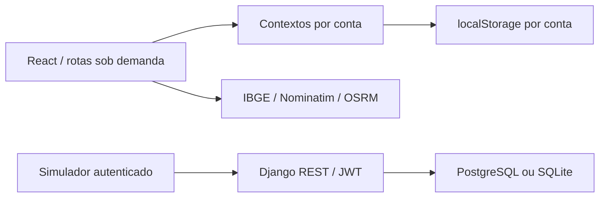

# Revisão de arquitetura — 08/10/2026

## Diagnóstico

O projeto possui duas camadas independentes: uma SPA React com dados locais e uma API Django com JWT. A interface não consome os cadastros da API; o login `admin / admin` habilita apenas a demonstração local. O ID `999999` continua sendo a conta demo, com dados iniciais disponíveis sem backend.

Não há ligação entre os contextos de cadastros e a API no estado atual. A separação local por conta não representa autorização multi-tenant no servidor.

## Correções implementadas

| Problema encontrado | Correção |
| --- | --- |
| Build bloqueado por imports, variáveis e campo `efficiency` ausentes | Remoção dos símbolos sem uso, tipos explícitos e estimativa opcional de km/l |
| Efeitos de troca de conta podiam salvar dados da conta anterior na nova chave | Providers internos reiniciados por ID; leitura inicial síncrona e persistência vinculada à mesma conta |
| Lista `[]` tratada como ausência e repovoada com mock | Somente ausência/estrutura inválida aciona fallback; exclusões persistem na demo |
| Valores financeiros aleatórios alteravam contas reais a cada cinco segundos | Simulação limitada à conta demo, com limpeza do temporizador |
| JSON inválido, armazenamento bloqueado ou quota excedida derrubavam contextos | Leitura validada e escrita protegida em `storage.ts`; payload inválido preservado em chave com sufixo `_recovery` antes do fallback, quando o armazenamento permite |
| Conta ativa inexistente deixava interface sem contexto | Fallback explícito para Admin Global |
| Marketplace relia armazenamento antes de o estado novo ser persistido | Remoção da atualização assíncrona redundante; React passa a ser a fonte do estado |
| ESG e roteirização usavam flags diferentes entre Marketplace e menu | Mapeamento único para menu e acesso direto às rotas; seleção ESG incluída no cadastro |
| Cadastro em uma aba não aparecia no seletor de outra | Sincronização da lista de contas pelo evento `storage` |
| Todas as páginas, mapas e gráficos carregados junto com a entrada | Imports dinâmicos por página e layout operacional; providers de frota só nas rotas protegidas |
| Partículas recalculadas em cada renderização | Posições e transições criadas uma vez por montagem |
| Primeiro veículo em conta vazia recebia ID `-Infinity` | Cálculo do próximo ID inclui zero como base |
| Valores zero de combustível/pneus substituídos por 100 na edição | Operador `??` preserva zero |
| Resposta antiga de municípios podia sobrescrever a UF atual | Cancelamento de requisições e atualização funcional da cidade no cadastro de veículos |
| CRUD da API acessível sem autenticação | Permissão global `IsAuthenticated`; cadastro e emissão/renovação de JWT permanecem públicos |
| Registro aceitava `cargo`/`is_active` do cliente e ignorava política de senha | Campos de privilégio somente leitura; email obrigatório e validadores Django de senha |
| Quatro modelos sem migrações | Migração `0003` cria alertas, OS, ESG e consolidados diários |
| Modelo histórico de posições removido do Python, ainda existente na migração inicial | Restauração de `Telemetria`; tabela histórica preservada e exposta em `/posicoes/` |
| Flags de Conta removidas do código, ainda existentes no banco | Restauração dos campos de telemetria e assistente, sem apagar dados |
| Simulador usava `/vehicles`, `/telemetry` e campos em inglês | Contrato Django em `/veiculos/` e `/posicoes/`, JWT, timeout e tratamento de HTTP; usa biblioteca padrão |
| Chave de desenvolvimento fixa, hosts/CORS irrestritos e senha PostgreSQL rastreada | Configuração por ambiente e `.env.example`; produção exige `SECRET_KEY` |
| Compose gerava migrações durante inicialização e não aguardava banco | Somente executa migrações versionadas e aguarda healthcheck PostgreSQL |
| Imagem frontend Node 18 incompatível com Vite 7 | Node 22 e instalação reproduzível com `npm ci` ([requisito do Vite](https://vite.dev/guide/)) |
| Contextos de build Docker podiam incluir dependências, bancos e arquivos de ambiente | `.dockerignore` específico em cada contexto |
| Inicializador Windows não aplicava migrações nem atualizava dependências Python já instaladas | Script valida `.env`, instala requirements e interrompe a inicialização se a migração falhar |
| Dependências com vulnerabilidades conhecidas | Django 5.2 LTS, DRF, SimpleJWT, Gunicorn e dotenv corrigidos; lockfile npm atualizado sem forçar mudanças de major |

Django permanece na família 5.x, agora na [linha 5.2 LTS](https://docs.djangoproject.com/en/5.2/releases/5.2/). O `requirements.txt` registra versões exatas. As auditorias medem avisos conhecidos nas bases consultadas, não certificam ausência de falhas na aplicação.

## Código e arquivos removidos

- `frontend/src/App.css`: CSS padrão do Vite sem importação.
- `frontend/public/vite.svg`: ícone padrão sem referência.
- `frontend/public/dashboard_mockup.png` e `meu_dashboard_print.png`: sem referências; a Landing utiliza `imac_mockup.png`. Economia aproximada de 799 KiB.
- `frontend/tailwind.config.js`: configuração v3 não carregada pelo Tailwind v4; tokens e variante dark estão em `src/index.css`.
- `backend/core/permissions.py`: classe sem referências, dependente de `user.perfil`, atributo que não existe no modelo `Usuario`. A API usa a permissão global explícita.
- Dependências `axios` e `bpmn-js`: sem importações no código.
- Ícone `Car` artesanal duplicado: substituído pelo componente da biblioteca já utilizada.
- Mocks de previsões, imports e variáveis sem consumo; import global duplicado do CSS Leaflet.
- `refreshContas`, indicador constante `isLoading` e `VITE_API_URL` sem consumidor: removidos para não sugerir uma integração HTTP inexistente.

Os documentos de planejamento, vídeo da Landing, `imac_mockup.png`, scripts operacionais, dump SQL e banco legado foram preservados. A ausência de importação não prova que documentos e dados históricos sejam descartáveis.

## Pendências arquiteturais

1. **Prioridade alta — autorização multi-tenant no backend.** `Usuario` não possui vínculo com `Conta`; `Veiculo` e `Motorista` não pertencem a uma conta no esquema atual. Usuários autenticados ainda acessam os mesmos conjuntos globais. Antes de atender clientes reais, definir associação usuário–conta, propriedade dos ativos, filtros em todos os ViewSets e validação de FKs entre contas. A atribuição dos registros históricos exige regra de negócio; não foi inventada durante esta revisão.
2. **Prioridade alta — autenticação e cadastros reais na SPA.** O booleano `ecoFleet_auth` e as credenciais demo não autenticam a API. Integrar JWT, renovação, expiração de sessão, adaptadores dos campos em português/inglês e persistência no servidor. Manter a conta demo em um fluxo separado ao realizar essa integração.
3. **Prioridade alta — banco SQLite legado inconsistente.** O `backend/db.sqlite3` rastreado apresenta `admin.0001_initial` aplicado sem `core.0001_initial`. Foi preservado. A validação utiliza banco novo; o `.env.example` aponta para `fleetmonitor.local.sqlite3`. Recuperar o legado requer backup e auditoria do esquema/dados; não usar `--fake` indiscriminadamente. Retirar bases com dados do Git deve ser uma ação de saneamento específica, com preservação e revisão do histórico.
4. **Escala — consultas e histórico.** As listas da API continuam sem paginação; posições IoT crescerão continuamente. Definir contrato paginado, ordenação, índices por veículo/data, retenção e agregação. Não foi adicionada paginação silenciosamente porque alteraria o contrato atual de listas.
5. **Financeiro — precisão.** Custos e receitas usam `FloatField`. Planejar `DecimalField` e validações de domínio com migração e política de arredondamento.
6. **Dados demonstrativos.** Relatórios, indicadores e alguns alertas ainda usam mocks. Sua substituição precisa de fontes e regras reais; removê-los como “código morto” eliminaria funcionalidades visíveis.
7. **Produção.** O Compose segue voltado a desenvolvimento (Vite e `runserver`). Definir build estático, proxy TLS, servidor WSGI/ASGI, gestão de segredos, backup e observabilidade antes de publicar.
8. **Sincronização local.** O evento `storage` sincroniza a lista de contas entre abas, mas cadastros locais não oferecem resolução de edições simultâneas ou sincronização entre dispositivos. Isso depende da integração com o servidor.

## Validação

- `npm run build`: compilação TypeScript estrita e bundle Vite.
- `npm run lint`: sem desabilitar globalmente verificações de tipos ou hooks.
- `npm test`: seis regressões em React StrictMode (isolamento, demo, listas vazias, temporizador, recuperação de armazenamento e módulos/abas).
- `python manage.py check` e `makemigrations --check --dry-run`: modelos e migrações alinhados.
- `python manage.py migrate`: executado no banco de revisão, sem modificar o SQLite legado.
- `python manage.py test core`: cinco testes da API, incluindo contrato real do simulador e preservação de `/telemetria/` para consolidados diários.
- `npm audit` e `pip-audit -r requirements.txt`: sem vulnerabilidades conhecidas após a atualização (inicialmente 18 avisos npm e 54 avisos Python).
- Smoke test no build de produção com navegador isolado: login demo, dashboard nos dois temas, sete páginas operacionais, cadastro de conta e redirecionamento de módulo desabilitado; nenhum erro JavaScript capturado. Capturas do dashboard conferidas visualmente.
- O JavaScript da entrada passou a aproximadamente 246 kB (80 kB gzip), com gráficos, mapas e layout em chunks carregados quando necessários; não há chunks acima de 500 kB.
- CI adicionada em `.github/workflows/ci.yml` para repetir build, lint, testes, migrações e auditorias. Os comandos foram validados localmente; a execução remota da workflow depende do envio ao GitHub.

Docker não está instalado neste ambiente; o Compose e as imagens não puderam ser executados. O comportamento de autorização por conta no servidor não é coberto como implementado, pois permanece pendente.
